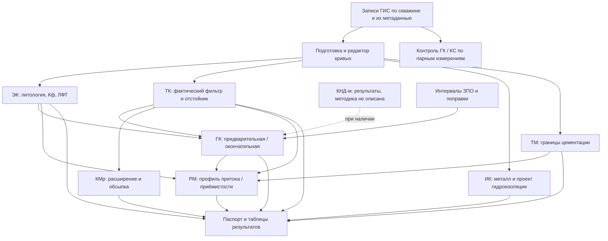

# Альфа 2018: карта источника

Состояние исследования: 13.10.2026. Полное название на обложке: «Руководство пользователя. Программы комплексной интерпретации данных ГИС Альфа», Алматы, 2018. Файл — [локальный PDF](../Руководство_пользователя_программы_Альфа_2018.pdf). 183 страницы; PDF metadata сообщает создание/изменение 10.12.2018. SHA-256: `82bd3bd0ec8e40591ebc3676346428c89bfe48fe30a7f3788d73fb733b6490e5`.

## Разделы и применимость

| PDF / печатные страницы | Содержание | Значение для KAPGEO |
|---|---|---|
| 1–4 | Обложка, оглавление, назначение, состав модулей и обмен через Рабочий стол | Предметная карта методов и результатов; архитектуру DLL/EXE не переносить |
| 5–9 | Установка/настройка Windows и AtomGeo | За границами будущего автономного прототипа |
| 10–14 | DAT/LAS, выбор скважины, сохранение данных и шаблона | Идентичность записи/скважины и разделение исходных данных и представления |
| 15–28 | Планшет: треки, заголовок, шкалы, сетка, подписи, заливки, глубина/значение | Основа общего UX планшета |
| 29–66, §4.1 | Дифференциальная интерпретация ГК, предварительная/окончательная, поправки, ЗПО, фильтр, ЗАДР, таблицы/паспорт, примеры КНД | Новый крупный предметный контур, сейчас отсутствует |
| 67–84, §4.2 | КС/ПС: обзорная/детальная литология, уровни, нормировка, Кф, ЛФТ, соседняя скважина | Ближайшее расширение существующих литологии/КС |
| 85–89, §4.3 | ТК: фактический фильтр, пескоотстойник, наблюдения по колонне | Основа фактической конструкции, зависимость ГК/КМр/РМ |
| 90–93, §4.4 | ИК в обсаженной скважине: глубины металла, проектные интервалы | Самостоятельный метод и сравнение проекта/факта |
| 94–114, §4.5 | ТМ: линия фона, цементация, сложные/повторные термограммы | Интервальная интерпретация с ручной оценкой и неопределённостью |
| 115–123, §4.6 | КМ после расширения: диаметр, проект/факт, обсыпка | Самостоятельные результаты КМр; не подменяют исходную КМ для ГК |
| 124–131, §4.7 | РМ: точечные измерения, корректировка, секции фильтра, дифференциальная гистограмма | Производный профиль по общему дебиту и фактическому фильтру |
| 132–151, §4.8.1 | Контроль ГК: производственные, КПС и безрудные разведочные скважины | Парные записи, сопоставляемые интервалы, показатели качества |
| 152–159, §4.8.2 | Контроль КС по площади и глубине | Отдельный сценарий контроля КС |
| 160–164, §4.9 | Сдвиг/обрезка/вырезание/арифметика/замена значений кривых | Предобработка с сохранением исходника и производной записи |
| 165–177, §5 | Загрузка/выгрузка/замена в AtomGeo | Только предметное различие записей и результатов; интеграция исключена |
| 178–182, §6 | Паспорт, A3, масштаб, JPEG, печать, замечание к легенде | Будущий самостоятельный экспорт планшета, не экспорт разреза |
| 183, §7 | Разработчики | Не функциональное требование |

## Как изучено

Извлечён текст всех страниц; проверены оглавление, нумерация и тематические диапазоны. Содержательно прочитаны вводные с. 2–4, загрузка/планшет 10–28, основной интерпретационный блок 29–164, обмен 165–177 и паспорт 178–182. Страницы установки 5–9 выделены как нерелевантные реализации. Обложка и изображения сверены по рендерам: 42 страницы в семи обзорных листах, дополнительно детально 39, 47, 130, 138. Полный перечень — [визуальный индекс](./visual-reference-index.md).

Перечень программ на с. 5 дополнительно проверен из-за упоминания `KND.exe`; инструкции установки не рассматриваются как план работ. Пустой извлечённый текст страницы не означает отсутствие содержания: обложка и многие примеры представлены изображениями. Формулы с наложенными символами и числовые таблицы нельзя переносить из text extraction без отдельной сверки. Исследование подтверждает состав поведения, но не метрологическую корректность реализации формул и не актуальность нормативов 2010–2017 годов на сегодня.

## Предметные зависимости

Это зависимости информации по руководству, не обязательная линейная блокировка всех действий. Например, предварительная ГК и ручное изучение кривой возможны до завершения полного комплекса. Будущий UI должен различать отсутствие зависимого результата и запрет конкретного расчёта.

## Различия, которые нельзя потерять

- `КМ` — первичная кавернометрия для поправок ГК; `КМр` — после расширения для геометрии/обсыпки. С. 40 прямо исключает КМр из поправки ГК.
- `Проектный фильтр`, `предлагаемая посадка` и `фактический фильтр по ТК` — разные сущности/происхождение, даже при совпадении глубин.
- `ЗПО` по скважине — интервалы глубин; ручные линии окисления геотехнологического разреза принадлежат другому документу. Общая предметная тема не означает текущую связь данных.
- Керновая привязка/сводная литология KAPGEO основаны на другом РП; отсутствие этих операций в Альфе не является основанием удалять их.
- Значение `Кф`, класс `ЛФТ`, литотип и бинарная проницаемость различаются. Нельзя заменить их одним `kind: permeable/impermeable`.
- `Результат расчёта`, его ручная корректировка, отображаемая шкала и экспортный паспорт должны иметь отдельный жизненный цикл. Старый Рабочий стол помогает понять обмен, но не диктует web-навигацию.
